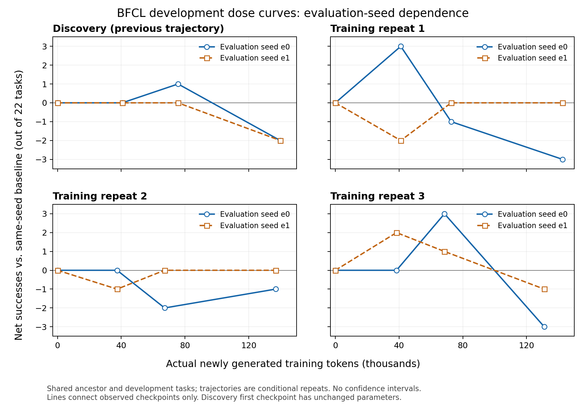

# 旧发现轨迹与新训练重复：已完成的剂量评测

2026-10-11。旧发现轨迹、三条新训练重复的三个检查点及共享起点，在两个评测 seed 下的全部面板已审计通过。完整批次解释、成本与下一决策见 [36](36_dose_repeats_complete.md)。



图只使用完整且已审计的双 seed 曲线；横轴是实际新生成训练 token，纵轴是相对同 seed 起点的净成功题数。连线仅连接检查点，不代表连续效应估计；四条完整曲线全部绘出。[PDF](figures/bfcl_completed_dose_curves_20261011.pdf) 与 [来源/绘图数值](figures/bfcl_completed_dose_curves_20261011.sources.json) 可单独导出，图表核对已通过。

## 旧发现轨迹

| 实际训练 token | 起点 0 | 32K 标签 40,641 | 64K 标签 75,677 | 128K 标签 139,839 |
|---|---:|---:|---:|---:|
| e0 成功题数 / 22 | 12 | 12 | 13 | 10 |
| e1 成功题数 / 22 | 11 | 11 | 11 | 9 |
| e0 相对同 seed 起点 G（题数） | 0 | 0 | +1 | −2 |
| e1 相对同 seed 起点 G（题数） | 0 | 0 | 0 | −2 |

32K 状态参数未改变，两套 seed 内各自与起点的 22 条原始交互逐项相同。它是未改参数政策的推理对照，不构成有效学习阶段的收益证据。

中间状态的一题净增益没有在 e1 重现。终点在两个 seed 都净下降两题，但具体受影响任务不同：两次都改善 task 134、损失 task 154，其他变化依赖 seed。只能说这条旧轨迹的终点在两次已测开发评测中均低于起点，不能扩大为训练普遍有害或已找到最佳停止点。

## 新训练重复 1

| 实际训练 token | 起点 0 | 32K 标签 41,078 | 64K 标签 72,708 | 128K 标签 142,590 |
|---|---:|---:|---:|---:|
| optimizer step | 0 | 3 | 6 | 13 |
| e0 成功题数 / 22 | 12 | 15 | 11 | 9 |
| e1 成功题数 / 22 | 11 | 9 | 11 | 11 |
| e0 相对同 seed 起点 G（题数） | 0 | +3 | −1 | −3 |
| e1 相对同 seed 起点 G（题数） | 0 | −2 | 0 | 0 |

早期状态已有真实参数更新，与旧轨迹 32K 状态参数未变的情况不同；相同预算标签不代表相同实际剂量或相同政策。早期 e0 的净 +3 在 e1 变成净 −2，首次正向单点不支持稳定收益，见 [E007](experiments/E007.md)、[E009](experiments/E009.md)。

中间政策两次都是 11/22，却有六题成败不同；相对各自起点分别净 −1/0。早期→中间的变化是 e0 −4、e1 +2，方向相反。成功总数相同不代表原始结果一致，见 [E012](experiments/E012.md)、[E014](experiments/E014.md)。

终点 e0 为 9/22，净 −3；e1 为 11/22，净 0。终点较中间的变化为 −2/0。e0 的终点下降没有在 e1 重现，这条新轨迹尚不支持跨评测 seed 稳定退化，更不能选择早期最佳点。终点 e1 改善 task 134、153，损失 123、186，净变化为零但任务表现确有变化，见 [E013](experiments/E013.md)、[E015](experiments/E015.md)。

六个检查点评测累计 **382,134 新生成 token**，其中终点 e1 为 66,054；共享起点评测仍记在批次账本，不在本小计重复收费。此处只有一条新的条件训练轨迹、两个评测 seed 与共享题目，不估计精确总体方差，不将面板当独立科学样本。

## 新训练重复 2

| 实际训练 token | 起点 0 | 32K 标签 37,386 | 64K 标签 67,236 | 128K 标签 136,960 |
|---|---:|---:|---:|---:|
| optimizer step | 0 | 3 | 6 | 13 |
| e0 成功题数 /22 | 12 | 12 | 10 | 11 |
| e1 成功题数 /22 | 11 | 10 | 11 | 11 |
| e0 相对同 seed 起点 G（题数） | 0 | 0 | −2 | −1 |
| e1 相对同 seed 起点 G（题数） | 0 | −1 | 0 | 0 |

六个检查点及两个共享基线均审计通过，逐面板证据见 [E016](experiments/E016.md)、[E017](experiments/E017.md)、[E018](experiments/E018.md)、[E019](experiments/E019.md)、[E020](experiments/E020.md)、[E021](experiments/E021.md)。六个检查点评测总计 **406,613 新生成 token**，共享起点不在小计重复入账。

早期两个 seed 八题成败不同，中间七题不同。早期→中间变化为 e0 −2、e1 +1，方向相反；repeat 1 同一比较为 −4/+2。相同早期阈值标签下 repeat 1/2 的相对高低也依赖 eval seed：e0 为 15/12，e1 为 9/10；实际训练 token 为 41,078/37,386，不能将标签当相同实际剂量，不据此选择赢家。

终点两个 seed 均为 **11/22**，但有 6 题成败不同，相对同 seed 起点净 −1/0。e0 改善 134、128，损失 26、166、123；e1 改善 128、71，损失 23、123。终点较中间为 **+1/0**，与旧轨迹 −3/−2 及 repeat 1 −2/0 不同；旧轨迹的末段下降没有成为已测重复的共同规律。

repeat 2 所有已测检查点均未高于同 seed 起点；这不支持这条条件轨迹的训练增益，但不能用有限开发题和两个 eval seed 证明总体无效。两条新重复共享祖先和题目，第三条完整结果见下节；不将这些面板当独立科学样本或估计纯方差分量。

## 新训练重复 3

| 实际训练 token | 起点 0 | 32K 标签 38,398 | 64K 标签 68,514 | 128K 标签 131,152 |
|---|---:|---:|---:|---:|
| optimizer step | 0 | 4 | 6 | 10 |
| e0 成功题数 /22 | 12 | 12 | 15 | 9 |
| e1 成功题数 /22 | 11 | 13 | 12 | 10 |
| e0 相对同 seed 起点 G（题数） | 0 | 0 | +3 | −3 |
| e1 相对同 seed 起点 G（题数） | 0 | +2 | +1 | −1 |

六个检查点及共享起点均通过审计，见 [E022](experiments/E022.md)–[E027](experiments/E027.md)。六个检查点评测累计 **381,624 新生成 token**，共享起点不在小计重复入账。

早期 e0/e1 七题成败不同，净 0/+2。中间净 +3/+1，是新重复中唯一双 seed 均高于起点的检查点；但两个 seed 改善的具体题目不重合，前两条训练重复也未重现双正增益。早期→中间变化为 +3/−1，方向依赖 eval seed。

终点 e0/e1 为 9/10，净 −3/−1，终点较中间 −6/−2；中间的正向观察未保持到终点。e1 改善 task 153，损失 123、189；该面板新增 63,117 token。两个终点政策输出仅一题成败不同，但相对各自起点的变化仍须分别计算，不能把跨 seed 政策分数差当作 G 的差。

三条新轨迹的终点六个面板都没有净正收益；不过 repeat 2 的末段变化 +1/0 与其他两条不同，不能声称共同末段退化或根据峰值选早停。总体效应和经验价值预测仍需独立新设计。

## 决策与复现

31 的完整冻结对照已全部完成并通过 E028 审计，见 [36](36_dose_repeats_complete.md)。32 的恢复验收按原非零 AdamW/梯度结构选源，不因分数改点；33 的任务组预测设计继续等待恢复验收后冻结。当前批次仅开发集，未新增使用 21 道保留迁移题。

机器证据：[旧轨迹双 seed](rl/bfcl_discovery_two_eval_seeds_20261011.json)、[repeat 1 双 seed](rl/bfcl_repeat_1_two_eval_seeds_20261011.json)、[repeat 2 双 seed](rl/bfcl_repeat_2_two_eval_seeds_20261011.json)、[repeat 3 双 seed](rl/bfcl_repeat_3_two_eval_seeds_20261011.json)。复现不新增模型调用：

```bash
python pipeline/report_bfcl_discovery_repeats.py
python pipeline/report_bfcl_training_repeat.py --protocol rl/BFCL_DOSE_REPEATS_PROTOCOL_20261011.json --repeat repeat_1 --output rl/bfcl_repeat_1_two_eval_seeds_20261011.json
python pipeline/report_bfcl_training_repeat.py --protocol rl/BFCL_DOSE_REPEATS_PROTOCOL_20261011.json --repeat repeat_2 --output rl/bfcl_repeat_2_two_eval_seeds_20261011.json
python pipeline/report_bfcl_training_repeat.py --protocol rl/BFCL_DOSE_REPEATS_PROTOCOL_20261011.json --repeat repeat_3 --output rl/bfcl_repeat_3_two_eval_seeds_20261011.json
python pipeline/plot_bfcl_completed_dose_curves.py
```
