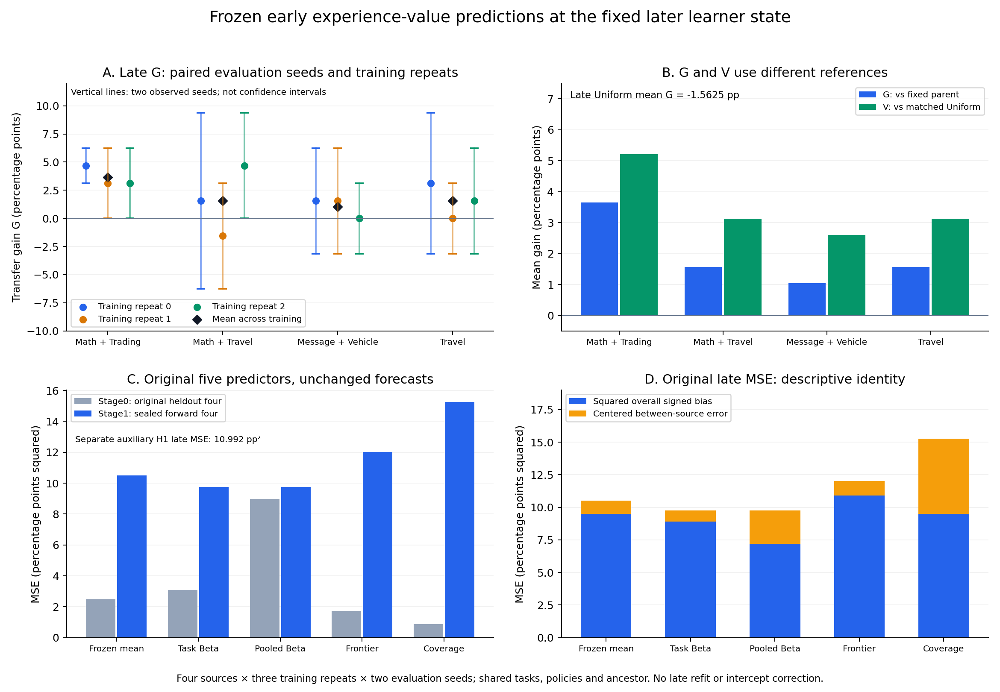

# Stage1：冻结早期预测的15训练／32面板前向验证

完整原始重放通过：15条在线RL训练、32个目标面板。四来源平均G为＋1.9531个百分点，平均V为＋3.5156个百分点。原任务级Beta点预测MSE比冻结均值低7.20%，但绝对误差以整体高估为主，来源排序的重复稳定性有限。以下是本固定父状态、同四来源与同32题条件下的结果；不等于整个研究Goal完成。

## 研究问题、协议与实际执行

研究对象是在线经验获取—完整学习状态下的RL更新—训练后迁移收益。共同起点固定为原Stage0 Uniform repeat0完整7步终点，未按分数换祖先。原五个早期预测器的模型、标准化与20个实际晚阶段点预测，以及独立H1的4个预测，均在晚训练和全部目标标签之前封存并核验发布。本批按用户事前决定只做原四个留出来源×3训练重复＋3 Uniform；没有晚阶段内拟合，原完整晚51/104延后。

G是终点相对同阶段共同起点的收益；V再减去对应训练重复、对应评测seed的Uniform收益。先配对相同任务和seed，再平均2个评测重复及3个训练重复。来源、任务、训练重复、评测重复和共享祖先形成依赖。

## 逐来源收益与重复差异

| 来源 | 早G(pp) | 晚G(pp) | 晚V(pp) | 晚G：r0/r1/r2(pp) | 晚V：r0/r1/r2(pp) |
| --- | --- | --- | --- | --- | --- |
| MathAPI+TradingBot | 4.1667 | 3.6458 | 5.2083 | 4.6875 / 3.1250 / 3.1250 | 7.8125 / 4.6875 / 3.1250 |
| MathAPI+TravelAPI | 5.2083 | 1.5625 | 3.1250 | 1.5625 / -1.5625 / 4.6875 | 4.6875 / 0.0000 / 4.6875 |
| MessageAPI+VehicleControlAPI | 7.8125 | 1.0417 | 2.6042 | 1.5625 / 1.5625 / 0.0000 | 4.6875 / 3.1250 / 0.0000 |
| TravelAPI | 6.2500 | 1.5625 | 3.1250 | 3.1250 / 0.0000 / 1.5625 | 6.2500 / 1.5625 / 1.5625 |

晚阶段Uniform的G为−3.1250、−1.5625、0个百分点，平均-1.5625个百分点。因此本批四个平均V均为正，不能解释成每个来源都稳定带来正G。例如TravelAPI r1的G=0，而V=＋1.5625pp。四来源平均G从早期5.8594pp降至1.9531pp；变化不是所有来源等量下移，具体见error_description.json。

只有MathAPI+TradingBot在三个训练重复的平均G均严格为正。六个匹配来源对中，2个在三个训练重复同向；其中1个同时在两个评测重复的跨训练平均对比中保持方向。它们是描述性敏感性分析，不是独立重复、置信区间或显著性判据。完整配对值见post_batch_description.json与gains_by_training_repeat.csv；G/V同类排序不是第二份复制。

## 原封存预测与实测

| 来源 | 冻结均值预测G(pp) | 任务级Beta预测G(pp) | 组合级Beta预测G(pp) | Frontier预测G(pp) | Coverage预测G(pp) | H1预测G(pp) | 实测G(pp) |
| --- | --- | --- | --- | --- | --- | --- | --- |
| MathAPI+TradingBot | 5.0347 | 5.0510 | 5.7810 | 5.4711 | 3.0979 | 4.7554 | 3.6458 |
| MathAPI+TravelAPI | 5.0347 | 5.0964 | 5.4737 | 5.5777 | 6.5411 | 4.4786 | 1.5625 |
| MessageAPI+VehicleControlAPI | 5.0347 | 4.7122 | 1.3486 | 5.5777 | 6.5411 | 5.8624 | 1.0417 |
| TravelAPI | 5.0347 | 4.8830 | 5.9306 | 4.3931 | 3.9587 | 4.8784 | 1.5625 |

| 原五模型 | Stage0原留出MSE(pp²) | Stage1前向MSE(pp²) | Stage1 RMSE(pp) |
| --- | --- | --- | --- |
| 冻结均值 | 2.49415 | 10.4965 | 3.23984 |
| 任务级Beta | 3.08969 | 9.74029 | 3.12094 |
| 组合级Beta | 8.97235 | 9.75778 | 3.12374 |
| Frontier | 1.70645 | 12.0101 | 3.46556 |
| Coverage | 0.880183 | 15.2682 | 3.90746 |

独立辅助H1的晚阶段MSE为10.992304 pp²。H1早期拟合是在Stage0标签开放后另行登记的探索模型；本次4个晚预测为事前封存，不能把H1写成原五模型中的第六个确认性模型。

任务级Beta晚阶段RMSE为3.1209pp，冻结均值为3.2398pp。其点MSE低于均值7.20%，低于组合级Beta约0.18%。任务级相对均值在2/4来源、3/3训练重复视图、2/2评测重复视图中改善；这些视图共享同一组封存预测及相关标签，不是独立复制。原Stage0任务级Beta未胜过均值的结果继续保留。

每个来源的原始特征、早期均值/标准差、z、截距、斜率、lambda、原预测、实测G/V及误差均在frozen_predictions_and_observations.csv。原任务级/组合级/Frontier/Coverage斜率为正，辅助H1斜率为负；MSE降低不推出高信号来源更值得采样。

## 整体水平与来源关系的误差分解

| 模型 | 原MSE(pp²) | 整体偏差平方(pp²) | 中心化来源误差(pp²) | 平均预测−实测(pp) |
| --- | --- | --- | --- | --- |
| 冻结均值 | 10.4965 | 9.49624 | 1.0003 | 3.0816 |
| 任务级Beta | 9.74029 | 8.89535 | 0.84494 | 2.9825 |
| 组合级Beta | 9.75778 | 7.18429 | 2.57349 | 2.6804 |
| Frontier | 12.0101 | 10.9015 | 1.10863 | 3.3017 |
| Coverage | 15.2682 | 9.49624 | 5.772 | 3.0816 |

使用原预测的恒等式MSE=平均误差²＋中心化误差。任务级Beta的91.33% MSE属于整体偏差平方；它相对均值的MSE改善约79.46%来自这一分量差，其余来自中心化来源误差差。组合级Beta整体高估较少但来源间误差更大；Coverage相对均值的额外误差全部来自中心化来源分量。这里没有用晚标签校正截距或报告校正后预测。六个两两对比只编码同一个中心化分量。

## 完整学习状态与有效依赖

本批继承完整AdamW状态。E313/E316的MessageAPI+VehicleControlAPI r0/r1均有5次更新、0次新非零梯度、5次参数变化；父状态动量非零且weight decay=0，与继承动量作用一致，未做数值反事实重放。它们本次平均G均为＋1.5625pp，不能归因为新经验提供了有效奖励梯度。G包含完整学习状态下的获取与更新总作用，V没有剥离动量、步数、任务暴露和剂量差异。

15个训练终点实际只有14个不同的可训练权重指纹。相同政策对在相同评测seed下的outcomes、rollouts和generation_calls字节SHA比较见post_batch_description.json；原三重复和两次真实推理成本全部保留，不把副本冒充独立政策。

## 实际成本与失败边界

| 环节 | 新生成模型token | 输入token位置（不含padding） | 外部tool token | rollouts |
| --- | --- | --- | --- | --- |
| probe | 2021895 | 33708915 | 246546 | 696 |
| training | 1082991 | 20243452 | 139492 | 452 |
| evaluation | 3314701 | 59231376 | 387634 | 1024 |

本晚阶段三环节合计新生成6,419,587 token，共享探测只计一次，继承父状态成本重计为0。训练实际1,082,991，名义983,040，完整组超额99,951（10.17%），仍在登记上限内。113次更新、33次新非零梯度步骤、113次参数变化。逐分支剂量见training_dose.csv。训练与评测worker wall之和分别为14.742与91.333小时；它们包含加载/CPU环境工作，不是GPU-active时间或严格FLOPs。输入位置按实际调用重复计数，不是独特数据量；外部tool token不混入生成预算。

原32科学子进程均RC0且未触发硬超时，无科学任务重跑。首次评测准入的出版查询故障（E323，0科学child）、证据后处理误报（E326）和后续Git/SSH查询或传输故障另列于完整执行审阅。发布故障不当作训练负结果，也不因此重新采样。成本范围是原Stage1探测＋15训练＋32评测，不是整个旧项目全部工程试验总账。

## Claim–evidence与未完成范围

| 陈述 | 证据 | 结论边界 |
| --- | --- | --- |
| 真实在线RL干预和迁移评测已完成 | E321、原15训练证书、32评测证书及逐面板E325–E357（E326为后处理恢复） | 更新/梯度/参数变化与迁移收益分别报告；审计通过不是正收益。 |
| 四来源晚阶段平均G为正 | 主报告labels与gains_by_training_repeat.csv | 仅MathAPI+TradingBot在三个训练重复均G>0；评测seed仍有波动。 |
| 四来源平均V均为正 | 主报告labels与对应Uniform | 晚阶段Uniform平均G为负；V>0不推出G>0，也不去除剂量和动量影响。 |
| 任务级Beta在本次前向检验的点MSE低于冻结均值 | 原封存预测、完整主报告prediction_results | 4个来源、同32题、新eval seeds；不是稳定采样规则或整类方法胜利。 |
| 局部机会预测优势在两个学习状态出现 | 原Stage0报告、E303完整晚阶段探测 | 共享模型家族、任务与祖先；局部Brier优势不是迁移收益证明。 |
| 误差同时包含整体水平和来源关系变化 | error_description.json的原MSE恒等分解及同四来源变化 | 没有修正截距、重新拟合、创造新预测或把六个对比当独立复制。 |
| 部分零新梯度分支仍有参数变化和正G | E313、E316、固定父优化器上下文及本报告 | 与继承动量解释一致；未做数值反事实重放，不能归因于新经验奖励梯度。 |
| 两个训练重复的政策和部分评测证据重复 | post_batch_description.json的SHA比较 | 保留原三重复和实际成本；不能把相同政策/seed下的副本当独立条件。 |
| 已有可追溯的原始证据与检查点取得方式 | docs/stage1_forward15_reproduction.md与原evidence_manifest | Git不含模型二进制；当前环境元数据不是补写的历史安装连续性证明。 |
| 整个研究Goal尚未完成 | 原scope、NEXT与SCOPE_REVIEW | 机制广度、ID、规模/家族/环境外推及21题另行协议仍有缺口；不自动补回完整晚51/104。 |

仍未覆盖：晚阶段内重拟合及完整16来源排序、不同机制候选的充分比较、独立ID收益、模型规模/家族与环境外推，以及另行协议下的21道保留题。原五模型中多数是同类代理或历史结构信号，不能据此声称机制广度已经完成。下一科学批次须说明关键解释、正/负/不确定结果如何改变决定、资源上限和停止条件；本报告不自动恢复完整晚51/104，也不宣布整个Goal完成。

## 文件、复现与审阅归属

原始机器结果：audit_status.json（完整15/32原始重放）；解释分解：error_description.json；本页及post_batch_description.json由执行agent整理，不是独立人类复核。冻结协议、原始输入、点预测、当前实际环境及检查点取得方式见../../docs/stage1_forward15_reproduction.md。所有模型二进制仍按原manifest在授权服务器取得，Git clone不是完整模型包。

图中训练重复的细线连接两个评测seed，属于原始配对范围而非置信区间；菱形是三个训练重复均值。误差堆叠图使用原MSE恒等分解。作图输入为plot_data.json，不生成新模型预测。
